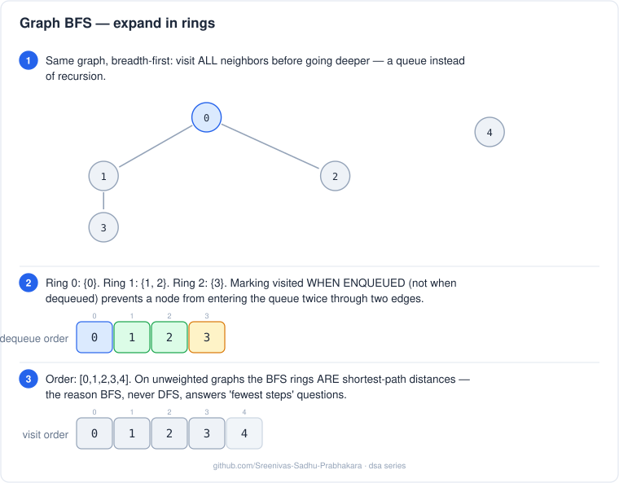

# Graph BFS Traversal

> Striver SDE Sheet 154 · Day 23 Graph — queue-driven level expansion; marking on *enqueue* is the correctness detail that stops double-queueing. Go, stdlib only, tested.

## Problem

The breadth-first visit order of an undirected graph — nodes in increasing distance from each component's start.

## Approach

Swap DFS's stack for a queue and depth-first becomes distance-first: nodes come out in non-decreasing hop distance, which is why BFS *is* unweighted shortest paths (and why Rotten Oranges and Dijkstra-with-unit-weights reduce to it). The one discipline difference from tree BFS: mark visited **when enqueueing**, not when dequeueing — in a graph two frontier nodes can share a neighbor, and dequeue-time marking lets that neighbor slip into the queue twice. The outer component loop mirrors the DFS repo (#153); the pair of repos differ by one data structure, which is the lesson.

**Complexity:** O(V+E) time, O(V) space.

## Visual walkthrough

Read the picture top to bottom — each numbered frame is one moment of the algorithm
running on this repo's test example.

## Run

    go test ./...   # verify
    go run .        # demo

---

One of 191 repos solving Striver's SDE Sheet in Go — stdlib only, one problem per repo, every solution tested. Browse the set: [`dsa-*` repos](https://github.com/Sreenivas-Sadhu-Prabhakara?tab=repositories&q=dsa-&type=source).
